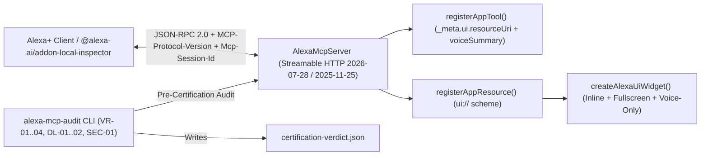

# `alexa-mcp-kit`

**Zero-Dependency Agentic Code Mode, Progressive Tool Discovery, Adaptive 3-Display-Mode UI Generator (`Inline`, `Fullscreen`, `Voice-only`), and Pre-Flight Readiness Linter SDK for Amazon Alexa+ MCP Apps.**

[](./LICENSE)
[](https://developer.amazon.com/docs/alexa-plus/mcp-get-started.html)
[](https://www.npmjs.com/package/@alexa-ai/addon-local-inspector)

---

## Why `alexa-mcp-kit` Exists (Complementing `@alexa-ai/addon-local-inspector`)

Amazon's official **`@alexa-ai/addon-local-inspector`** is the gold-standard **inspection and testing tool** for validating an already-built Alexa+ MCP server across Echo Show and Fire TV viewports. However, before you can inspect a server, you still have to **build** it from scratch.

`alexa-mcp-kit` is the **developer authoring & runtime SDK** that sits on the server side and makes any Node.js MCP server immediately ready for `@alexa-ai/addon-local-inspector`:

1. **Streamable HTTP (`2026-07-28` + `2025-11-25` / `2025-06-18` Multi-Revision Negotiation):** While the latest upstream MCP spec (`2026-07-28`) uses stateless HTTP with `MCP-Protocol-Version` headers and `_meta["io.modelcontextprotocol/protocolVersion"]`, Amazon's `@alexa-ai/addon-local-inspector` negotiates `2025-06-18` / `2025-11-25` stateful sessions via `Mcp-Session-Id`. `alexa-mcp-kit` negotiates all four revisions (`2026-07-28`, `2025-11-25`, `2025-06-18`, `2025-03-26`) seamlessly and returns `-32022` (`UnsupportedProtocolVersionError`) for unknown versions.
2. **Progressive Tool Discovery (`search_tools` & `describe_tool`):** Instead of dumping dozens of full JSON Schemas into every LLM turn, `server.enableProgressiveDiscovery()` exposes lightweight keyword/category search and on-demand schema inspection—saving **~68%–92% of prompt context tokens**.
3. **Isolated V8 Agentic Code Mode (`execute_codemode`):** `server.enableCodeMode()` lets Alexa+ compose multi-step JavaScript plans chaining atomic `api_*` lookups and parameterized `calc_*` formulas inside a zero-privilege `node:vm` sandbox (`process`, `require`, and raw `fetch` stripped) in a single turn.
4. **Dual `_meta.ui.resourceUri` Binding & Adaptive 3-Display-Mode UI Generator (`createAlexaUiWidget`):** Automatically binds `tools/list` and `tools/call` to `text/html;profile=mcp-app` resources (`Inline`, `Fullscreen`, and `Voice-only`) while computing real **WCAG 2.1 AA (`>= 4.5:1`)** contrast ratios from CSS `<style>` declarations and enforcing `>= 48px` far-field touch targets.
5. **Fast CI Pre-Flight Readiness Linter (`alexa-mcp-audit`):** Parses actual `<style>` CSS color variables and `.touch-target` rules from live `resources/read` HTML responses and verifies JSON-RPC handshakes in `<100ms` before you launch the full Playwright-based `npx @alexa-ai/addon-local-inspector`.

---

## Architecture



---

## Quick Start (Zero Dependencies, Node >= 18)

```javascript
import {
  AlexaMcpServer,
  createAlexaUiWidget,
  runCertificationAudit
} from "alexa-mcp-kit";

const server = new AlexaMcpServer({
  name: "my-alexa-addon",
  version: "1.0.0"
});

// 1. Register an adaptive 3-mode ui:// widget resource
server.registerAppResource({
  uri: "ui://my-addon/summary-card",
  name: "Savings Summary Widget",
  render: ({ displayMode, state, voiceSummary }) =>
    createAlexaUiWidget({
      uri: "ui://my-addon/summary-card",
      title: "Monthly Utility Audit",
      subtitle: "Verified against OpenEI Time-of-Use schedules",
      displayMode,
      voiceSummary: voiceSummary || "Ready to audit your utility rate.",
      metrics: [
        { label: "Current Bill", value: `$${state?.billed ?? 240}` },
        { label: "Off-Peak Target", value: `$${state?.target ?? 172}` },
        { label: "Annual Savings", value: `$${state?.annualSavings ?? 816}`, tone: "danger" }
      ]
    })
});

// 2. Register an Alexa+ tool bound to the ui:// resource
server.registerAppTool({
  name: "analyze_rate",
  title: "Analyze Utility Rate",
  description: "Calculates peak vs off-peak savings for a household.",
  resourceUri: "ui://my-addon/summary-card",
  inputSchema: {
    type: "object",
    required: ["billed"],
    properties: {
      billed: { type: "number" }
    }
  },
  handler: async ({ billed }) => {
    const target = Math.round(billed * 0.72);
    const annualSavings = (billed - target) * 12;
    return {
      voiceSummary: `Shifting heavy appliances to off-peak hours saves $${billed - target} per month, or $${annualSavings} per year.`,
      structuredContent: { billed, target, annualSavings }
    };
  }
});

const { url } = await server.listen(3050);
console.log(`Alexa+ MCP Server listening at ${url}`);
```

---

## Pre-Certification CLI Auditor (`alexa-mcp-audit`)

Before running `@alexa-ai/addon-local-inspector` or submitting to Alexa+ certification, run the built-in auditor against any live MCP endpoint:

```bash
node ./bin/alexa-mcp-audit.mjs http://127.0.0.1:3050/mcp --out=./
```

### Rules Evaluated

| Rule ID | Category | Requirement |
| :--- | :--- | :--- |
| **`DL-01`** | Protocol & Schema | Streamable HTTP (`2026-07-28` + `2025-11-25` / `2025-06-18`) handshake, `MCP-Protocol-Version` & `Mcp-Session-Id` headers, valid JSON Schema on all tools |
| **`DL-02`** | Voice-First Fallback | Every tool returns a non-empty `_meta.voice.summary` and every `ui://` resource embeds spoken text + `<speak>` SSML |
| **`VR-01`** | Visual Resource Binding | Every tool declares `_meta.ui.resourceUri` (`ui://...`) matching a registered `text/html;profile=mcp-app` resource |
| **`VR-02`** | Adaptive Multimodal Layout | Every `ui://` resource renders switchable `<section>` panels for `inline`, `fullscreen`, and `voice-only` |
| **`VR-03`** | Accessibility & Contrast | WCAG 2.1 AA minimum contrast ratio `>= 4.5:1` across all foreground/background token pairs |
| **`VR-04`** | Far-Field Touch Ergonomics | Minimum interactive touch target `>= 44x44px` (`48x48px` default) |
| **`SEC-01`** | Sandbox Security & RPC Bridge | Strict `Content-Security-Policy` (`default-src 'none'`) and `window.parent.postMessage` (`ui/initialize` & `tools/call`) |

---

## Running the Verification Suite

`alexa-mcp-kit` ships with an automated end-to-end verification suite covering multi-revision Streamable HTTP negotiation (`2026-07-28`, `2025-11-25`, `2025-06-18`), WCAG 2.1 AA CSS contrast parsing, 3-display-mode HTML generation, negative compliance rejection (`CERTIFIED` vs. `NOT_CERTIFIED`), progressive tool discovery (`search_tools` & `describe_tool`), and isolated `node:vm` Code Mode execution (`execute_codemode`):

```bash
npm test
```

---

## Companion Reference Application

See **[`billshield-mcp`](https://github.com/savhascelik/billshield-mcp-)** for a complete 19-tool Alexa+ household financial defense & recall claim add-on built on top of `alexa-mcp-kit`.

---

## License

Released under the [MIT License](./LICENSE).
